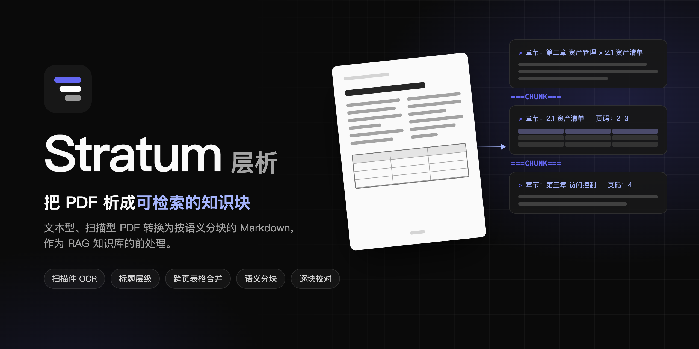

<div align="center">


# Stratum 层析

**把 PDF 析成可检索的知识块**

[](requirements.txt)
[](app/server.py)
[](web/package.json)
[](docs/deployment.md#许可证)

[特性](#特性) · [快速开始](#快速开始) · [文档](#文档)



</div>

Stratum 层析把文本型和扫描型 PDF 转换为按语义分块的 Markdown。每块带有章节路径和页码，块之间用分隔符隔开。转换结果可以作为 RAG 知识库的前处理产物，导入任何支持自定义分隔符的知识库。

## 特性

- **解析方案**：默认使用 PyMuPDF + RapidOCR，支持切换到通过 HTTP 调用的 OXR。
- **扫描件 OCR**：默认方案自动识别没有文字层或文字乱码的页。OXR 识别整份文档。
- **标题层级**：系统根据编号体例、字号和书签目录还原章节结构。
- **跨页续接**：跨页、跨栏的段落和表格自动合并，页眉、页脚、页码自动删除。
- **语义分块**：系统按章节和段落分块，每块第一行写出章节路径和页码。
- **逐块校对**：导入前，你可以逐块编辑结果，并对照原 PDF。
- **版本管理**：系统把本机目录作为项目，结果按版本保存在 PDF 旁边。

## 快速开始

前置条件：Python 3.12，Chrome 或 Edge 浏览器。

```bash
./run.sh            # 默认端口 8000；第一次运行时自动创建 .venv 并安装依赖
./run.sh 9000       # 指定端口
```

1. 在浏览器中打开 `http://localhost:8000/`。
2. 点击「选择目录」，选择一个包含 PDF 的目录。
3. 在左侧列表中点击一个 PDF。
4. 在抽屉中点击「开始解析分块」。
5. 确认解析参数，点击「开始解析」。
6. 在「分块」视图中检查结果。
7. 点击「保存到目录」。

## 文档

| 文档 | 内容 |
| --- | --- |
| [功能详解](docs/features.md) | 解析与分块规则、输出示例、已知局限 |
| [使用指南](docs/guide.md) | 转换流程、项目与版本、导入 RAG 知识库 |
| [解析配置](docs/configuration.md) | 解析方案、识别参数与分块参数 |
| [部署](docs/deployment.md) | 环境变量、安全、性能参考、许可证 |
| [开发](docs/development.md) | 目录结构、测试、前端构建、品牌素材 |

> [!WARNING]
> 服务没有登录鉴权。依赖的 PyMuPDF 使用 AGPL-3.0 许可证。部署前阅读[部署文档](docs/deployment.md)。
